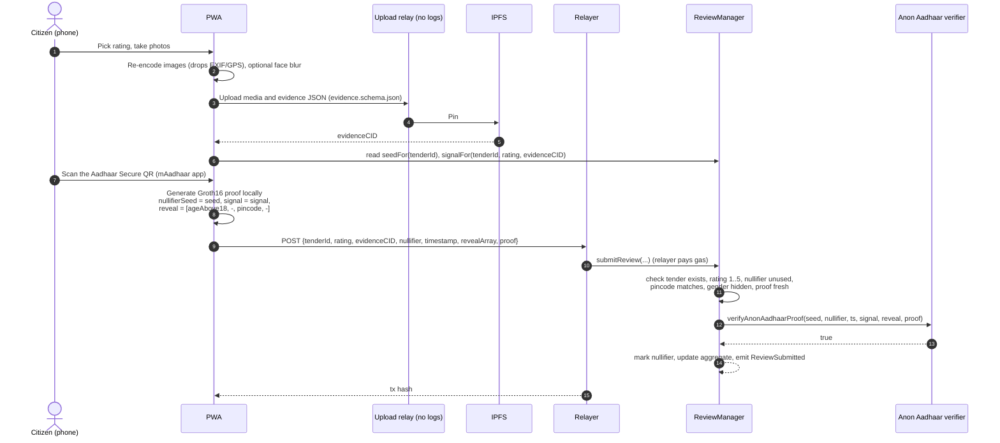
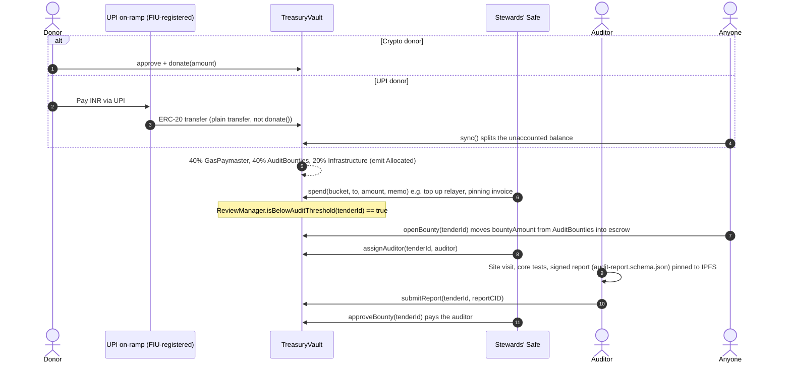

# Architecture

Status: Phase 1 (proof of concept). Target network: Polygon Amoy (chainId 80002).

## Components

| Component | Where | Status |
|---|---|---|
| `TenderRegistry` | `packages/contracts/contracts/TenderRegistry.sol` | Implemented and tested |
| `ReviewManager` | `packages/contracts/contracts/ReviewManager.sol` | Implemented and tested, using a mock Anon Aadhaar verifier |
| `TreasuryVault` | `packages/contracts/contracts/TreasuryVault.sol` | Implemented and tested: split, spend, on-ramp sync, audit bounties |
| Stewards' Safe | Safe{Wallet}, not custom code | Deploy at app.safe.global; it owns all three contracts |
| IPFS documents | `packages/schemas/` | JSON Schemas for tender, evidence and audit report |
| Relayer | not started | Submits `submitReview` transactions, paid from the GasPaymaster bucket |
| PWA frontend | not started | Next.js + `@anon-aadhaar/react` |
| `QuadraticFunding` | deferred | See design-review.md §6 |
| Tender ingestion oracle | deferred to Phase 3 | See design-review.md §5 |

```
                ┌──────────────────────┐
  stewards ───► │  Safe multisig (m/n) │ owns / admin
                └──────────┬───────────┘
          ┌────────────────┼─────────────────────┐
          ▼                ▼                     ▼
  TenderRegistry ◄── ReviewManager ◄──────── TreasuryVault
  (pincode, CID)     (nullifiers,        (buckets, bounties;
                      aggregates)         reads isBelowAuditThreshold)
                          │
                          ▼
                 Anon Aadhaar verifier (external, Groth16)
```

## Workflow 1: Tender onboarding (Phase 1, manual)

```mermaid
sequenceDiagram
    autonumber
    actor S as Steward
    participant P as Govt portal (CPPP / KPPP)
    participant I as IPFS pinning
    participant Safe as Stewards' Safe
    participant R as TenderRegistry

    S->>P: Download NIT, work order, BOQ (PDF)
    S->>S: sha256 every file; fill tender.schema.json
    S->>I: Pin PDFs, then the metadata JSON
    I-->>S: metadataCID
    S->>Safe: Propose registerTender(keccak(ref), keccak("GSTIN:"+id), valuePaise, awardedAt, deadline, pincode, CID)
    Safe->>R: Executes after m-of-n signatures
    R-->>R: emit TenderRegistered (indexed by the dashboard / subgraph)
```

In Phase 1 a steward can also hold `REGISTRAR_ROLE` directly from an EOA, which saves collecting signatures for each of the 20–50 pilot tenders. Revoke it before mainnet.

## Workflow 2: Anonymous citizen rating



What makes this anonymous and safe:
- **The proof authorises the review, not the sender.** `submitReview` never reads `msg.sender`, so the citizen holds no wallet and leaves no on-chain account that links their reviews.
- **Nullifier per tender.** The seed differs per tender, so one person's nullifiers on two projects are unrelated numbers.
- **The signal binds the proof to the review.** A relayer cannot change the rating or swap the evidence (covered by a test).
- **The evidence is uploaded before the proof is made**, because its CID is part of the signal.

## Workflow 3: Donations and treasury



The dashboard can be rebuilt entirely from events: `Donation`, `UnaccountedFundsSynced`, `Allocated`, `Spent`, `Bounty*`. Invariant (tested): `token.balanceOf(vault) == sum(bucketBalance) + escrowedForBounties` after every `sync`.

## On-chain ↔ IPFS links

| On-chain field | Computed from (IPFS JSON) |
|---|---|
| `Tender.externalRefHash` | `keccak256(utf8(tender.referenceNumber))` |
| `Tender.contractorIdHash` | `keccak256(utf8(contractor.idType + ":" + contractor.idValue))` |
| `Tender.awardedValuePaise` | `award.awardedValuePaise` |
| `Tender.pincode` | `uint32(location.pincode)` |
| `Tender.metadataCID` | CID of the tender JSON |
| `ReviewSubmitted.evidenceCID` | CID of the evidence JSON |
| `Bounty.reportCID` | CID of the audit report JSON |

The indexer should **re-validate every pinned JSON against its schema and these equalities**, and flag any mismatch. Nothing on-chain enforces them.
